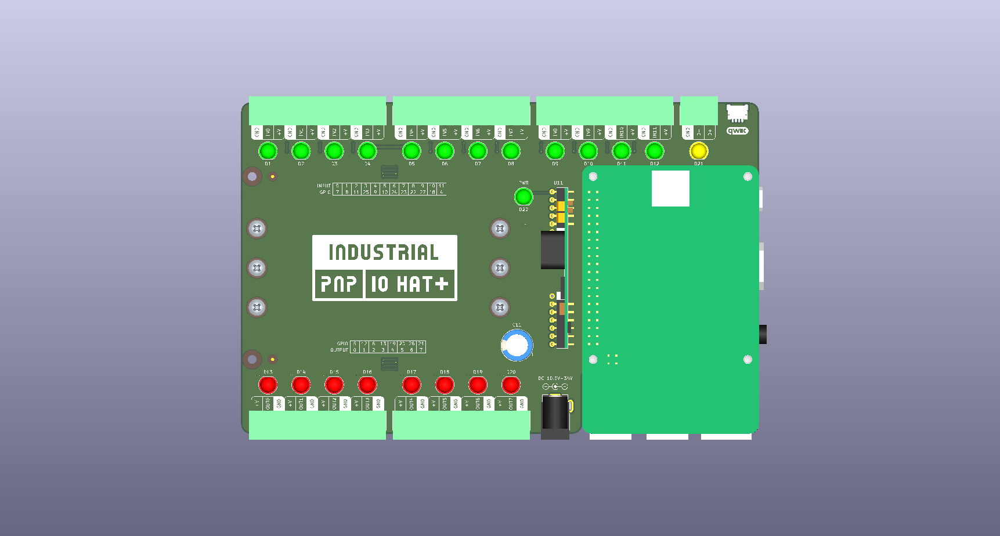

# Industrial PNP IO HAT+ for Raspberry Pi

Many industrial sensors, actuators, and indicator lights use 24V digital signals.
The [GPIO on the Raspberry PI 40-pin header](https://pinout.xyz/), are strictly 3.3V and not directly compatible with these devices.
This board adapts the GPIO on the Raspberry Pi to be able to interface with these higher voltage signals.

Industrial 24V signals come in two main flavors: PNP and NPN.
PNP signals are **on** when connected to 24VDC and **off** when disconnected (left floating).
NPN signals are **on** when connected to 0V (GND) and **off** when disconnected.

Where I live and work PNP signals are overwhelmingly more popular.
They are also a bit more intuitive for most people.
The digital inputs and outputs on this board are for PNP signals.

This IO board is designed to mount to DIN rail.
DIN rail is the dominant electronics mounting system in industry.
It comes in several varieties, but the most common is DIN 3 also known as "top hat".
This system is primarily designed to work with DIN 3 rail.

This board conforms to the [Raspberry Pi HAT+ specification](https://pip-assets.raspberrypi.com/categories/1215-raspberry-pi-hat/documents/RP-008281-DS-1-hat-plus-specification.pdf)

## Components

### Custom Components (The Circuit Board)
The circuit board can be ordered from [OSH Park](https://oshpark.com/shared_projects/fHu9WALf).
Gerber and Excellon drill files are also available in the gerbers folder.

### Purchased / Off-the-Shelf Components
| Ref.        | Qty. | Manufacturer    | Part Number           | Description                          | Notes                 |
| ----------: | ---: | :-------------- | :-------------------- | :----------------------------------- | :-------------------- |
| C1-C10      |   10 | KEMET           | C1206C104K5RACTU      | 0.1uF 1206 Ceramic Capacitor         |                       |
| C11         |    1 | Nichicon        | UVZ1H221MPD           | 220uF Aluminum Elecrolytic Capacitor |                       |
| D1-D12, D22 |   13 | Lite-On         | LTL2R3KGD-EM          | Green 5mm LED                        |                       |
| D13-D20     |    8 | Lite-On         | LTL2R3KRD-EM          | Red 5mm LED                          |                       |
| D21         |    1 | Lite-On         | LTL2R3KYD-EM          | Yellow 5mm LED                       |                       |
| D23         |    1 | onsemi          | MMSZ5239BT1G          | 9.1V SOD-123 Zener Diode             |                       |
| F1          |    1 | Littelfuse      | 0154005.DR            | 5A Fuse with Holder                  |                       |
| J1-J5       |    5 | Same Sky        | TBP03R1-350-12BE      | 12-Position Terminal Block Header    |                       |
| J6          |    1 | Same Sky        | TBP03R1-350-03BE      | 3-Position Terminal Block Header     |                       |
| J7          |    1 | Tensility       | 54-00167              | 5.5mm OD 2.5mm ID Barrel Jack        |                       |
| J8          |    1 | SparkFun        | PRT-14417             | QWIIC Connector                      |                       |
| J9          |    1 | Same Sky        | SSK04-FPH-254-B20     | 2x20 Socket Header                   |                       |
| P1-P5       |    5 | Same Sky        | TBP03P3-350-12BE      | 12-Position Terminal Block Plug      |                       |
| P6          |    1 | Same Sky        | TBP03P3-350-03BE      | 3-Position Terminal Block Plug       |                       |
| Q1-Q12      |   12 | onsemi          | MMUN2211LT1G          | Pre-Biased NPN SOT-23 Transistor     |                       |
| Q13         |    1 | Infineon        | IPD50P04P413ATMA2     | P-Channel TO-252 MOSFET              |                       |
| R1-R22      |   22 | YAGEO           | RC1206JR-07330RL      | 330 1206 Resistor                    |                       |
| R23         |    1 | YAGEO           | RC1206JR-071KL        | 1K 1206 Resistor                     |                       |
| R24-R26     |    3 | YAGEO           | RC1206JR-073K9L       | 3.9K 1206 Resistor                   |                       |
| R27, R28    |    2 | YAGEO           | RC1206JR-07100KL      | 100K 1206 Resistor                   |                       |
| SW1         |    1 | Same Sky        | SLW-662712-15A-SMT-TR | Slide Switch                         |                       |
| U1-U8       |    8 | Infineon        | BSP742TXUMA1          | High-Side Power Switch               |                       |
| U9          |    1 | onsemi          | CAT24C32WI-GT3        | EEPROM                               |                       |
| U10         |    1 | Analog Devices  | LTC2862AHS8-2#PBF     | RS-485 Transceiver                   |                       |
| U11         |    1 | MEAN WELL       | NID35-5               | 5V 3.5A Switching Voltage Regulator  |                       |
|             |    3 | Phoenix Contact | 1201578               | DIN Rail Adapter                     |                       |
|             |    4 | Pololu          | 1952                  | 11mm M2.5 Standoff                   | Comes in packs of 4   |
|             |    9 | McMaster-Carr   | 90380A349             | M3 x 8mm Lg. Thread-Forming Screw    | Comes in packs of 100 |
|             |    4 | McMaster-Carr   | 92005A066             | M2.5 x 6mm Lg. Pan Head Screw        | Comes in packs of 100 |
|             |    4 | McMaster-Catt   | 90591A270             | M2.5 Hex Nut                         | Comes in packs of 100 |

### 24VDC Power Supply
While not considered to be a part of this design, a 24V power supply will be needed to power the IO board.
It should be able to output at least 3A.
A suggested model is MEAN WELL `GST90A24-P1M`.
This model will also require a power cable; if you are in North America, Tensility `11-00022` should work.
The IO board has a built in fuse on its power input so an external fuse or circuit breaker is not needed.

### Raspberry Pi
You will also need a Raspberry Pi and SD card with an operating system (OS) loaded on it to make it function.
See the official Raspberry Pi [getting started](https://www.raspberrypi.com/documentation/computers/getting-started.html) documentation for details.
The IO board powers the Raspberry Pi, so a USB power supply is not needed.

### Replacement Fuse
If you happen to blow the fuse, the replacement part is Littelfuse `0451005.MRL`.

## Tools and Supplies
Various methods can be used to assemble this board.
The list of tools and supplies below is for the hand soldering method.

- A good soldering iron, preferably with temperature control - Please do not try to use a $5 soldering iron; these tend to have to overall effect of just making people hate soldering.
- Tweezers
- Solder - Leaded is easier to work with, but it's, well... leaded.
- Flux (optional) - I say optional, but if you are using lead-free solder, I would get it.
- Solder wick (optional) - If you anticipate screwing something up while soldering, this will help to fix things.
- Smoke absorber (optional) - I'm a non-smoker; I'd like to remain that way.
- A Phillips No.1 screwdriver
- A 5mm wrench

